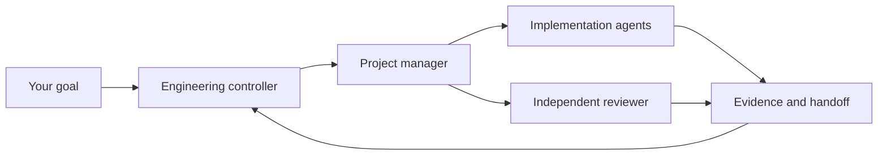

<div align="center">


# 神机百炼 / skill-forge-public

**Templates, skills, and handoff contracts for running multiple coding agents without losing track of who changed what.**

[简体中文](README.zh-CN.md) · **English** · [Quickstart](docs/QUICKSTART.md) · [Architecture](docs/ARCHITECTURE.md)


</div>

## Why this exists

Two coding agents edit the same area in parallel and step on each other's changes. Or a handoff comes back as "done, tests pass"—without saying which files moved, which inputs ran, or what stayed untested—so you end up digging through chat logs and stray diffs to reconstruct the state.

`skill-forge-public` addresses that failure mode with plain-text engineering rules, nine focused skills, and adapter references. It is not a background scheduler or an orchestration daemon. Start with a short charter and one bounded task; add roles only when parallel work justifies the coordination cost.

## What you get

| Failure mode | What the kit provides |
| --- | --- |
| Agents colliding on the same files | Explicit dependencies, isolated write scopes, one integration owner, and a single ledger writer |
| Re-explaining project rules every turn | A short [project charter](templates/project/AGENTS.md) with pointers to role-specific detail |
| Vague "done" handoffs | Fixed inputs, acceptance criteria, substantive receipts, and explicit `Unknown` / `NotRun` states |
| Risky updates and silent overwrites | `before` / `candidate` / `after` records, drift checks, and diff-scoped recovery steps |

### Nine reusable skills

Install only the skills your project uses; each lives under `skills/` with its own references:

| Skill | Focus |
| --- | --- |
| [`forge-writing-for-agents`](skills/forge-writing-for-agents/SKILL.md) | Writing agent rules, handoff entries, and skill instructions |
| [`forge-code-review`](skills/forge-code-review/SKILL.md) | Spec-and-evidence review of frozen candidates and diffs |
| [`forge-diagnosing-bugs`](skills/forge-diagnosing-bugs/SKILL.md) | Layer-by-layer fault isolation from raw evidence |
| [`forge-domain-modeling`](skills/forge-domain-modeling/SKILL.md) | Clarifying ambiguous terms, states, and authority boundaries |
| [`forge-pm-management`](skills/forge-pm-management/SKILL.md) | Initializing a PM and binding its actual receiving channel |
| [`forge-work-dispatch`](skills/forge-work-dispatch/SKILL.md) | Freezing work orders, routing tasks, and collecting receipts |
| [`forge-agent-recovery`](skills/forge-agent-recovery/SKILL.md) | Bounded continuation (up to 3 attempts) on native agent transient 429/502 errors |
| [`forge-ledger-reconcile`](skills/forge-ledger-reconcile/SKILL.md) | Reconciling project tracking entries against verified task evidence |
| [`forge-feedback`](skills/forge-feedback/SKILL.md) | Accumulating local project lessons and delivering batched updates at a fixed cut-off |

## Roles and flow



- **Controller** owns scope, trade-offs, acceptance, and the authoritative ledger.
- **PM** (optional) binds the real execution and receiving contract via [`forge-pm-management`](skills/forge-pm-management/SKILL.md), then runs work orders through [`forge-work-dispatch`](skills/forge-work-dispatch/SKILL.md). Keep both skill directories and their `references/` together when using a PM.
- **Executors** deliver complete work packages (implementation, focused checks, and evidence) inside their assigned paths.
- **Independent reviewer** is added only when risk or project rules call for one, and must come from an instance that did not implement the candidate.

Small tasks do not need all four roles.

## Try one reversible task first

```bash
git clone https://github.com/WeiBeta/skill-forge-public.git
cd skill-forge-public
```

The [quickstart](docs/QUICKSTART.md) walks through setup. The [sample work order](examples/task.md) describes a parser change. To try it, start with a small parser and tests in a copy of your project, or create a minimal fixture there. The parser should accept `ready` and `held`. The task is to reject a missing status while keeping both valid cases working.

1. From the clean Skill Forge checkout, run `python scripts/public_package.py verify .` with Python 3.10 or later. This checks the files against the [public manifest](docs/PACKAGES.md).
2. In your **test copy**, adapt the [charter](templates/project/AGENTS.md) to the project's existing rules. Use your harness's project-local installation method and check that its destination is inside the copy. If your harness only supports user-level skills, use a separate test profile with its own skill directory. Confirm that the harness loads the skills from the location you chose.
3. Give the executor the parser and its contract tests as its write scope. Ask for the exact change, the results for all three cases, and anything it could not run.
4. Compare the result with the starting copy. To undo the trial in a working project, preserve later edits, restore the changes you can attribute to the trial, and check the affected files against their original state. The [recovery guide](docs/DEPLOYMENT-RECOVERY.md) covers this comparison.

## Two routes and PM selection

- **Native Codex.** The [native adapter](adapters/codex-native/README.md) shows how to check which tools and configuration fields your installation supports.
- **Third-party models.** The [optional OpenCodex reference](adapters/opencodex/README.md) explains how to validate a routing layer. Its example wait settings apply to the versions listed there.
- **Collecting results.** A native GPT parent receives events or waits in an active turn. A third-party PM without reliable events checks a known child at bounded intervals. A Bridge PM pulls the result from the instance that dispatched the task and checks for pauses between waits. See the [routing table](docs/WORK-DISPATCH-MODELS.md) and [Bridge receiving guide](skills/forge-pm-management/references/bridge-receive.md).

## What to check locally

The package verifier checks the files you received. On your own host, verify that the skills load, an executor can return a result, and a saved change can be restored. The [validation guide](docs/VALIDATION.md) and [runtime contract](docs/RUNTIME-CONTRACT.md) explain what evidence to keep. Mark a check `NotRun` if you skipped it, and an outcome `Unknown` if you lack the evidence to decide.

## Repository layout

| Path | Contents |
| --- | --- |
| [`templates/project/`](templates/project/AGENTS.md) | Project charter template, role guides, management protocol, and empty ledgers |
| [`skills/`](skills/forge-work-dispatch/SKILL.md) | Nine engineering skills and their on-demand `references/` |
| [`examples/`](examples/task.md) | Synthetic work-order example for a small, reversible task |
| [`adapters/`](adapters/codex-native/README.md) | Codex-native route and optional OpenCodex reference |
| [`docs/`](docs/QUICKSTART.md) | Quickstart, architecture, runtime contract, permissions, validation, recovery, and upstream notes |
| [`scripts/`](docs/PACKAGES.md) | Standalone bundle verifier and reproducible ZIP builder (`scripts/public_package.py`) |

## Public edition and contributing

`skill-forge-public` is a generated public edition containing reusable methods, synthetic examples, and its own manifest (`PUBLIC-MANIFEST.json`). Customer deployments, operational logs, credentials, and recovery archives never enter this repository.

Issues and improvement proposals are welcome. Provide a minimal, sanitized reproduction and the behavior you expected, separating static checks from runtime observations. Accepted changes are integrated into the single maintained source first and then regenerated into this public repository.

## License and origins

Original and adapted skill-forge content is licensed under [GNU AGPL v3 only](LICENSE). Selected foundational methods originate from [Matt Pocock's skills](https://github.com/mattpocock/skills) and retain their [MIT license and attribution](third_party/mattpocock/LICENSE.txt). See [docs/UPSTREAM.md](docs/UPSTREAM.md) for the pinned upstream baseline and modification boundaries.

*The cover image (`assets/hero.png`) is a conceptual illustration generated for this project; it is not a product screenshot or performance evidence.*
