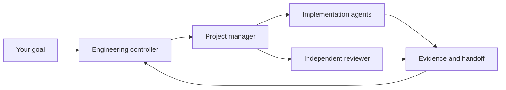

<div align="center">


# 神机百炼 / skill-forge-public

### Give every agent a role. Give every change a trail.

**An engineering playbook for teams made of agents.**

Turn a capable coding assistant into a coordinated team: an engineering controller, a project manager, and specialists who know their scope, their handoff, and what “done” means.

[简体中文](README.zh-CN.md) · **English** · [Start here](docs/QUICKSTART.md) · [Explore the architecture](docs/ARCHITECTURE.md)


</div>

## Build the team you actually need

Parallel agents are useful when their work can be separated, reviewed, and brought back together. skill-forge supplies the engineering habits around that work: short rule entry points, role-specific detail, bounded work orders, meaningful completion receipts, and recovery records.

Start with one agent and a small task. Add a PM and specialist roles as the project grows. Keep the process proportional to the work.

| What you want | What you get |
| --- | --- |
| More useful parallel work | Explicit dependencies, isolated write scopes, and clear integration ownership |
| Less repeated context | A short project charter with pointers to the rules each role needs |
| Consistent everyday work | Five reusable skills for writing instructions, reviewing code, diagnosing bugs, domain modeling, and dispatching work |
| Clear handoffs | Fixed inputs, acceptance criteria, evidence, and honest `Unknown` / `NotRun` states |
| Changes you can recover from | Before/candidate/after records, drift checks, and scoped recovery procedures |
| A workflow that fits your tools | A Codex-native route and an optional, version-scoped OpenCodex reference |

## A small core. Room to grow.



The controller owns scope and acceptance. The PM coordinates bounded work. Specialists deliver inside their assigned paths. Independent review comes from someone who did not implement the change. Smaller projects can use fewer roles.

## Start with one complete task

```bash
git clone https://github.com/WeiBeta/skill-forge-public.git
cd skill-forge-public
```

1. Read the [quickstart](docs/QUICKSTART.md) and adapt the [project charter](templates/project/AGENTS.md).
2. Choose the skills and roles your project needs. Install them using your harness's documented project-local mechanism.
3. Write one bounded work order: goal, fixed inputs, allowed paths, acceptance, and a completion receipt.
4. Verify the result before increasing concurrency.

Configuration examples are reference files. Cloning this repository does not change your permissions, credentials, model routes, or global settings.

## Choose your route

**Codex-native:** start with [the native adapter](adapters/codex-native/README.md). Check the interfaces and settings supported by your installed version.

**Third-party models:** [the OpenCodex reference](adapters/opencodex/README.md) shows how to think about an additional routing layer. Other routers and model combinations require their own validation.

These are engineering templates and skills, not a background scheduler or a promise of unattended operation. Runtime behavior, host discovery, resource release, and performance need verification in your environment. We do not claim universal zero-polling cost or a measured speedup from static checks.

## Find your way around

| Path | Purpose |
| --- | --- |
| [`templates/project/`](templates/project/AGENTS.md) | A project charter, role guides, and empty management templates |
| [`skills/`](skills/forge-work-dispatch/SKILL.md) | Five core engineering skills and focused references |
| [`adapters/`](adapters/codex-native/README.md) | Codex-native and optional OpenCodex guidance |
| [`docs/`](docs/QUICKSTART.md) | Setup, collaboration, validation, and recovery guidance |

## Open by design, private where it matters

This repository is a generated public edition of skill-forge. It contains reusable methods and synthetic examples; customer deployments, real operation logs, credentials, and recovery archives stay outside the public edition. Each public release has its own content manifest and verification boundaries.

Issues and contributions are welcome. Share a minimal, sanitized reproduction and the behavior you expected. Improvements are incorporated into the maintained source and then regenerated here, keeping one source of truth.

## License and origins

skill-forge's original and adapted content is licensed under [GNU AGPL v3 only](LICENSE). Selected foundational ideas come from [Matt Pocock's skills](https://github.com/mattpocock/skills); the upstream material retains its [MIT license and attribution](third_party/mattpocock/LICENSE.txt). See [the source notes](docs/UPSTREAM.md) for the fixed upstream baseline and modification boundaries.

The cover illustration was generated for this project. It represents the workflow concept; it is not a product screenshot or performance evidence.

<div align="center">

**Build with intent. Delegate with clarity. Ship with evidence.**

</div>
