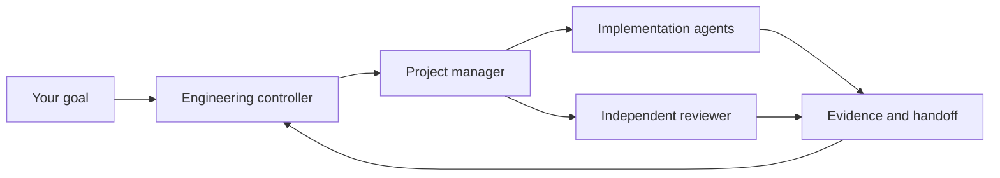

# 神机百炼 · skill-forge

### Give every agent a role. Give every change a trail.

**An engineering playbook for teams made of agents.**

Turn a capable coding assistant into a coordinated team: an engineering controller, a project manager, and specialists who know their scope, their handoff, and what “done” means.

[简体中文](README.zh-CN.md) · **English**

> **Project preview.** The first complete public edition is being prepared; independent review will precede its release. This repository currently publishes the project overview, artwork, and licenses; an installable release is not available yet.

## Build the team you actually need

Parallel agents become useful when their work can be separated, reviewed, and brought back together. skill-forge is being shaped around the engineering habits that make this possible: concise rule entry points, role-specific guidance, bounded work orders, meaningful handoffs, and recovery records.

Start with one agent and a small task. Add a PM and specialist roles as the project grows. Keep the process proportional to the work.

| What you want | What the public edition is designed to provide |
| --- | --- |
| More useful parallel work | Explicit dependencies, isolated write scopes, and clear integration ownership |
| Less repeated context | A short project charter with pointers to the rules each role needs |
| Consistent everyday work | Skills for writing instructions, code review, debugging, domain modeling, and dispatch |
| Clear handoffs | Fixed inputs, acceptance criteria, evidence, and honest unknowns |
| Changes you can recover from | Before/candidate/after records, drift checks, and scoped recovery procedures |
| A workflow that fits your tools | A Codex-native route and an optional OpenCodex reference |

## A small core. Room to grow.

The controller owns scope and acceptance. The PM coordinates bounded work. Specialists deliver inside their assigned paths. Independent review comes from someone who did not implement the change. Smaller projects can use fewer roles.

## What comes next

The first release will bring together project templates, focused skills, adapter guidance, and a verifiable public source package. The public edition is generated from one maintained source; real customer records, credentials, and recovery archives stay outside it.

This is an engineering toolkit, not a background scheduler or a promise of unattended operation. Runtime behavior and performance must be verified in your own environment. Other routers and model combinations require their own validation.

Follow [Releases](https://github.com/WeiBeta/skill-forge-public/releases) for the first complete edition. Ideas and minimal, sanitized use cases are welcome in [Issues](https://github.com/WeiBeta/skill-forge-public/issues).

## License and origins

skill-forge's original and adapted content uses [GNU AGPL v3 only](LICENSE). Selected foundational ideas come from [Matt Pocock's skills](https://github.com/mattpocock/skills); upstream material retains its [MIT license and attribution](third_party/mattpocock/LICENSE.txt).

The cover illustration was generated for this project. It expresses the workflow concept; it is not a product screenshot or performance evidence.

**Build with intent. Delegate with clarity. Ship with evidence.**

