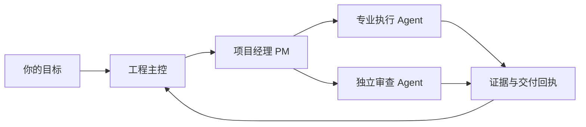

<div align="center">


# 神机百炼 / skill-forge-public

### 让每个 Agent 各司其职，让每次交付有据可循。

**把会写代码的助手，组织成会协作的工程团队。**

工程主控把握方向，项目经理组织推进，专业 Agent 在清晰边界内交付。让复杂工程有章可循，也让小任务保持轻盈。

**简体中文** · [English](README.md) · [从这里开始](docs/QUICKSTART.md) · [了解架构](docs/ARCHITECTURE.md)


</div>

## 从一个助手，到一支配合默契的工程队

多开几个 Agent 只是起点。任务如何拆分、谁能写哪些文件、结果由谁核收、出现偏差如何恢复，才决定并发工作能否真正汇合。

神机百炼把这些日常工程经验整理成可裁剪的范本与技能：总纲保持简短，角色按需读取细则；高频动作有固定步骤，交付留下可核对的证据。先跑通一个小任务，再按实际需要增加角色和并发。

| 你想解决的问题 | 神机百炼提供的起点 |
| --- | --- |
| 多人并行时相互踩文件 | 明确依赖、隔离写集和唯一集成责任人 |
| 每轮都要重讲一遍背景 | 总纲＋指针＋角色细则，减少重复上下文 |
| 同类工作每次做法不同 | 编写约束、代码审查、故障诊断、领域建模、派工回收、代理恢复、台账校对七类技能 |
| “做完了”却不知道完成了什么 | 固定输入、验收条件、证据与实质回执 |
| 更新后需要找回原状态 | before/candidate/after、漂移检查与有边界的恢复流程 |
| 想采用自己的模型组合 | 原生 Codex 主路线，以及可选的 OpenCodex 参考路线 |

## 一套小核心，随工程生长



主控负责范围、取舍和验收；PM负责协调；执行者在工单边界内交付；独立审查由未参与实现的人完成。角色按需启用，小项目不必照搬完整组织架构。

## 从一个完整闭环开始

```bash
git clone https://github.com/WeiBeta/skill-forge-public.git
cd skill-forge-public
```

1. 阅读[快速开始](docs/QUICKSTART.md)，裁剪[项目总纲](templates/project/AGENTS.md)。
2. 选择需要的技能与角色，按所用 harness 的官方方式安装到项目范围。
3. 写清一份工单：目标、固定输入、允许路径、验收标准与回执。
4. 核实结果，再逐步扩大并发。

配置文件都是参考示例。克隆仓库不会自动修改你的权限、凭据、模型路由或全局设置。

## 两条使用路线

**原生 Codex：** 从[原生适配说明](adapters/codex-native/README.md)开始，核对当前安装版本实际支持的接口与字段。

**第三方模型：** [OpenCodex 参考方案](adapters/opencodex/README.md)提供额外路由层的配置与验收思路。其他路由器、代理或模型组合需要单独验证，不能直接继承经验结论。

[派工模型与双 PM 选型](docs/WORK-DISPATCH-MODELS.md)提供按工作特性选档的参考表，以及兼顾经济性的双 PM 示例。这份说明独立于 Skill，只在选型时按需阅读。

本项目提供工程范本与技能，不是后台调度器，也不保证无人值守运行。宿主发现、运行行为、资源释放和性能需要在你的环境实测；静态检查不等于已证明零空转、加速比或业务收益。

## 内容导航

| 路径 | 内容 |
| --- | --- |
| [`templates/project/`](templates/project/AGENTS.md) | 项目总纲、角色细则和空白管理模板 |
| [`skills/`](skills/forge-work-dispatch/SKILL.md) | 七类工程技能与按需参考 |
| [`adapters/`](adapters/codex-native/README.md) | 原生 Codex 与可选 OpenCodex 路线 |
| [`docs/`](docs/QUICKSTART.md) | 启动、协作、验证与恢复说明 |

## 方法公开，客户资料独立保管

这里是神机百炼自动生成的 public 衍生版，提供通用方法和合成示例。真实客户部署、运维日志、凭据和恢复归档不进入公开版；每次公开发布都有独立内容清单与验证范围。

欢迎通过 issue 和贡献分享改进。请提供最小、已脱敏的复现材料及期望行为；改进会先进入统一维护源，再生成公开版本，避免长期分叉。

## 许可与来源

神机百炼的自有及改写内容采用 [GNU AGPL v3 only](LICENSE)。部分基础方法源自 [Matt Pocock 的 skills](https://github.com/mattpocock/skills)，上游材料保留其 [MIT 许可与版权归属](third_party/mattpocock/LICENSE.txt)。[来源说明](docs/UPSTREAM.md)列出固定上游基线和改写边界。

封面为本项目生成的概念插画，用于表达协作方式，不是产品截图或性能证据。

<div align="center">

**把目标交给团队，把边界写进工程，把结果留在证据里。**

</div>
