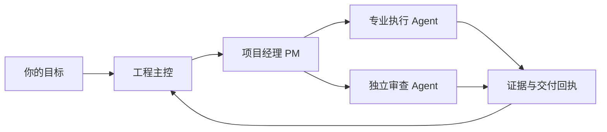

# 神机百炼 / skill-forge-public

### 让每个 Agent 各司其职，让每次交付有据可循。

**把会写代码的助手，组织成会协作的工程团队。**

工程主控把握方向，项目经理组织推进，专业 Agent 在清晰边界内交付。让复杂工程有章可循，也让小任务保持轻盈。

**简体中文** · [English](README.md)

> **项目预览。** 首个完整 public 版本正在准备，完整发布前会完成独立审查。当前仓库先公开项目介绍、视觉图和许可证，尚未发布可安装的完整版本。

## 从一个助手，到一支配合默契的工程队

多开几个 Agent 只是起点。任务如何拆分、谁能写哪些文件、结果由谁核收、出现偏差如何恢复，才决定并发工作能否真正汇合。

神机百炼围绕这些日常工程需求整理可裁剪的范本与技能：总纲保持简短，角色按需读取细则；高频动作有固定步骤，交付留下可核对的证据。先跑通一个小任务，再按实际需要增加角色和并发。

| 你想解决的问题 | 公开版本计划提供的起点 |
| --- | --- |
| 多人并行时相互踩文件 | 明确依赖、隔离写集和唯一集成责任人 |
| 每轮都要重讲一遍背景 | 总纲＋指针＋角色细则，减少重复上下文 |
| 同类工作每次做法不同 | 编写约束、代码审查、故障诊断、领域建模、派工回收五类技能 |
| “做完了”却不知道完成了什么 | 固定输入、验收条件、证据与实质回执 |
| 更新后需要找回原状态 | before/candidate/after、漂移检查与有边界的恢复流程 |
| 想采用自己的模型组合 | 原生 Codex 主路线，以及可选的 OpenCodex 参考路线 |

## 一套小核心，随工程生长

主控负责范围、取舍和验收；PM负责协调；执行者在工单边界内交付；独立审查由未参与实现的人完成。角色按需启用，小项目不必照搬完整组织架构。

## 接下来会带来什么

首版会汇集项目范本、工程技能、适配说明和可核验的公开源码包。public 版由统一维护源生成，真实客户记录、凭据和恢复归档独立保管。

本项目提供工程范本与技能，不是后台调度器，也不保证无人值守运行。运行行为与性能需在你的环境实测；其他路由器、代理或模型组合需要单独验证。

首个完整版本将发布在 [Releases](https://github.com/WeiBeta/skill-forge-public/releases)。欢迎通过 [Issues](https://github.com/WeiBeta/skill-forge-public/issues) 分享想法和最小、已脱敏的使用场景。

## 许可与来源

神机百炼的自有及改写内容采用 [GNU AGPL v3 only](LICENSE)。部分基础方法源自 [Matt Pocock 的 skills](https://github.com/mattpocock/skills)，上游材料保留其 [MIT 许可与版权归属](third_party/mattpocock/LICENSE.txt)。

封面为本项目生成的概念插画，用于表达协作方式，不是产品截图或性能证据。

**把目标交给团队，把边界写进工程，把结果留在证据里。**

