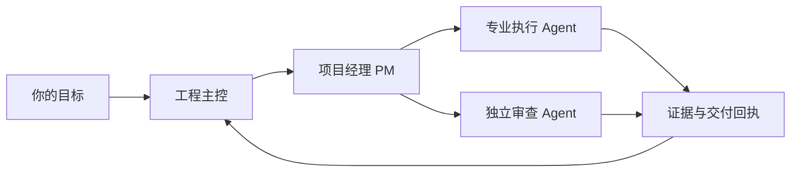

<div align="center">


# 神机百炼 / skill-forge-public

**一套用于组织多 Agent 工程协作的纯文本范本、技能集与交接合同。**

**简体中文** · [English](README.md) · [快速开始](docs/QUICKSTART.md) · [工程架构](docs/ARCHITECTURE.md)


</div>

## 为什么要做这套东西

两个 Agent 并行改代码，彼此踩进同一片文件；或者上一轮交接只留下一句“改完了，测试通过”，既没写动了哪几个文件、跑了哪组用例，也没写哪些路径没测，最后你只能翻聊天记录和零散 diff 拼现场。

神机百炼把多人并行协作里最容易出岔子的环节，整理成了可裁剪的工程总纲、九项按需加载的技能和适配参考。它不是后台调度器，也不是必须全套接入的框架——小项目从一份总纲和一张工单起步，确实需要并行时再逐项加上角色。

## 这套方法给了你什么

| 常见麻烦 | 提供的起点 |
| --- | --- |
| 并行改动互相踩文件 | 明确依赖、隔离写入路径、指定唯一集成责任人与唯一台账写入者 |
| 每轮都要重讲项目规矩 | 短[项目总纲](templates/project/AGENTS.md) + 指针 + 角色按需细则 |
| 交接只剩一句“做完了” | 固定输入、验收条件、实质回执，以及如实保留 `Unknown` / `NotRun` |
| 改完不敢回退、担心静默覆盖 | `before` / `candidate` / `after` 记录、漂移检查与按差额回退流程 |

### 九项可按需选用的技能

每项技能都在 `skills/` 下独立成目录，附带按需阅读的参考资料，按项目需要挑选用即可：

| 技能 | 解决的事 |
| --- | --- |
| [`forge-writing-for-agents`](skills/forge-writing-for-agents/SKILL.md) | 编写约束：写代理规则、派工材料、恢复入口与技能文档 |
| [`forge-code-review`](skills/forge-code-review/SKILL.md) | 代码审查：从规格与质量证据两轴审查冻结候选和差异 |
| [`forge-diagnosing-bugs`](skills/forge-diagnosing-bugs/SKILL.md) | 故障诊断：按原始证据分层定位故障，避免盲目重放副作用 |
| [`forge-domain-modeling`](skills/forge-domain-modeling/SKILL.md) | 领域建模：澄清工程术语、状态与权限边界歧义 |
| [`forge-pm-management`](skills/forge-pm-management/SKILL.md) | PM 初始化：按实际执行通道初始化 PM 并固定接收合同 |
| [`forge-work-dispatch`](skills/forge-work-dispatch/SKILL.md) | 派工与回收：按真实依赖冻结工单、路由派发并回收实质回执 |
| [`forge-agent-recovery`](skills/forge-agent-recovery/SKILL.md) | 代理恢复：针对原生代理模型服务层瞬态 429/502，向原实例最多有界续接 3 次 |
| [`forge-ledger-reconcile`](skills/forge-ledger-reconcile/SKILL.md) | 台账校对：在阶段核对或证据冲突时，按任务证据链修正台账 |
| [`forge-feedback`](skills/forge-feedback/SKILL.md) | 经验集中交付：平时本地积累工程经验，按固定截点异步集中交付 |

## 角色分工与流转



- **工程主控**：定范围、做取舍、核收结果，并单写权威台账。
- **项目经理（PM，按需启用）**：先用 [`forge-pm-management`](skills/forge-pm-management/SKILL.md) 绑定真实接收通道，再用 [`forge-work-dispatch`](skills/forge-work-dispatch/SKILL.md) 派工和回收；启用 PM 时，两个技能目录及各自 `references/` 需一并保留。
- **执行 Agent**：在允许写入路径内交付完整工作包（实现、针对性自测与证据）。
- **独立审查 Agent**：只在风险或项目合同需要时启用，由未参与实现的一方在干净上下文中核查。

小任务不必上完整角色，单主控配单执行者就能跑起来。

## 先用一个可逆的小任务跑通一次

```bash
git clone https://github.com/WeiBeta/skill-forge-public.git
cd skill-forge-public
```

先按[快速开始](docs/QUICKSTART.md)准备环境。[示例工单](examples/task.md)描述的是一次解析器修改。试做时，在项目副本里选一个已有的小解析器及其测试，或者先写一个最小样例和测试。解析器原本接受 `ready` 和 `held`。这张工单要让它在缺少状态时报错，并让两个合法状态照常通过。

1. 在刚克隆的神机百炼目录里，用 Python 3.10 或更高版本运行 `python scripts/public_package.py verify .`，核对收到的文件和[公开清单](docs/PACKAGES.md)。
2. 在**你自己项目的测试副本**里，参考[总纲范本](templates/project/AGENTS.md)补充已有规则。按宿主的项目级方式安装技能，先核对安装目录位于副本内。如果宿主只支持用户级安装，就用拥有独立技能目录的测试配置。最后确认宿主从选定的目录加载了技能。
3. 把写入范围限定为解析器和相应的契约测试。交付时让执行者说明改了什么、三种输入各得到什么结果、还有哪些检查没跑。
4. 对照起始副本看改动。如果要在工作项目里撤回试用，先保全后来加入的修改，只还原能确认属于本次试用的改动，再按原件核对。[恢复指南](docs/DEPLOYMENT-RECOVERY.md)给出了逐项比对的方法。

## 两条适配路线与 PM 选型

- **原生 Codex。** 从[原生适配说明](adapters/codex-native/README.md)开始，核对本机版本支持的工具与配置字段。
- **第三方模型。** 需要额外的模型路由层时，参考 [OpenCodex 适配说明](adapters/opencodex/README.md)做本地验证。等待设置示例有明确的适用版本。
- **派出去的活怎么收回来。** 原生 GPT 的直接父会话在活动回合内接事件或等待。第三方 PM 缺少可靠事件时，按约定间隔查询已知子任务。Bridge PM 从派出任务的实例拉取结果，每个等待窗口结束后先看有没有暂停指令。详见[派工选型表](docs/WORK-DISPATCH-MODELS.md)和 [Bridge 收件说明](skills/forge-pm-management/references/bridge-receive.md)。

## 哪些事情要在本机验证

验包脚本可核对收到的文件。技能能否加载、执行者能否把结果交回、保存的改动能否恢复，需要在自己的宿主上分别验证。[验收指南](docs/VALIDATION.md)和[运行合同](docs/RUNTIME-CONTRACT.md)说明了每项该留什么证据。没跑的检查记为 `NotRun`，证据不足以判断的结果记为 `Unknown`。

## 目录导航

| 路径 | 内容 |
| --- | --- |
| [`templates/project/`](templates/project/AGENTS.md) | 项目总纲范本、角色细则、管理协议与空白台账模板 |
| [`skills/`](skills/forge-work-dispatch/SKILL.md) | 九项工程技能及按需阅读的 `references/` |
| [`examples/`](examples/task.md) | 可逆小任务的合成工单样例 |
| [`adapters/`](adapters/codex-native/README.md) | 原生 Codex 主路线与可选 OpenCodex 参考 |
| [`docs/`](docs/QUICKSTART.md) | 快速开始、架构、运行合同、权限、验收、恢复与上游来源 |
| [`scripts/`](docs/PACKAGES.md) | 独立完整性校验与可复现打包脚本说明（`scripts/public_package.py`） |

## 公开版边界与贡献方式

`skill-forge-public` 是自动生成的公开衍生版，只包含通用方法、合成示例与独立内容清单（`PUBLIC-MANIFEST.json`）；真实客户部署、运维日志、凭据和恢复归档不进入公开仓库。

欢迎提交 issue 或改进建议：请附最小、已脱敏的复现材料和期望行为，并分开说明静态检查与实测观察。被采纳的改进会先进入统一维护源，再重新生成公开版本，避免长期分叉。

## 许可与来源

神机百炼自有及改写内容采用 [GNU AGPL v3 only](LICENSE)。部分基础方法源自 [Matt Pocock 的 skills](https://github.com/mattpocock/skills)，上游材料保留其 [MIT 许可与版权归属](third_party/mattpocock/LICENSE.txt)。固定上游基线与改写边界见 [docs/UPSTREAM.md](docs/UPSTREAM.md)。

*封面图（`assets/hero.png`）是为本项目生成的概念插画，用来表达协作方式，不是产品截图或性能证据。*
